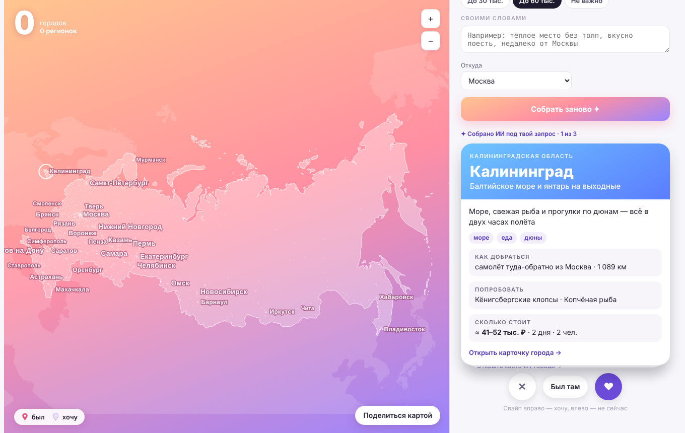

# Мои города

Прототип карты поездок для СберТревел: отмечаешь на карте России, где был и куда хочешь, ИИ подбирает города под настроение и время в дороге, для каждого «хочу» есть стоимость поездки, трек до билета и карточка города, а карту можно выложить в сторис.

Задача прототипа — проверить, превращает ли такая механика намерение «хочу поехать» в поиск и бронь в СберТревел и даёт ли повод заходить между поездками. Полное ТЗ для разработки — [docs/TZ.md](docs/TZ.md).



## Что внутри

| Часть | Что делает |
| --- | --- |
| Карта | Россия на закатном фоне. «Был» — сплошная геоточка, «хочу» — пунктирная. Зум, подписи без наложений, нажатие на город открывает карточку |
| ✦ Подбор (ген-UI) | Теги настроения, дорога и ползунок времени в пути, с кем, когда, бюджет, запрос своими словами. ИИ собирает колоду из 6 карточек и сам выбирает блоки на каждой. Свайп вправо — «хочу», влево — «не сейчас», кнопка «Был там» |
| Все города | 1 117 городов: центры регионов крупно, города региона раскрываются под ними. Поиск по названию |
| Мои поездки | «Хочу поехать» с бюджетом и прогрессом трека, «Где я был» со всеми отмеченными городами |
| Карточка города | Трек из 5 шагов до поездки, калькулятор стоимости, что попробовать, главный сувенир, где сделать фото, переход в СберТревел |
| Золотое кольцо | 10 городов (8 классических, Углич и Рыбинск). Золотые точки на карте, плашка прогресса, маршрут, участки которого закрашиваются по мере посещения |
| Сторис | Картинка 1080 × 1920 с картой, числом городов и регионов, прогрессом кольца и «дальше хочу» |

Скриншоты: [карточка города](screenshots/kartochka-goroda.png) · [мои поездки](screenshots/moi-poezdki.png) · [Золотое кольцо](screenshots/zolotoe-koltso.png) · [сторис](screenshots/storis.png)

## Как открыть

`index.html` — вся страница одним файлом, её можно открыть в браузере или выложить на GitHub Pages (Settings → Pages → Deploy from branch → `main`, папка `/`).

Живой прототип в Claude: [claude.ai/artifact/J8F2EdRMwJWT2yCogesNRh](https://claude.ai/artifact/J8F2EdRMwJWT2yCogesNRh).

**Что работает по-разному:**

- **ИИ в «Подборе».** В Claude подбор собирает модель через аккаунт смотрящего (`window.claude.use("sample")`). Вне Claude ИИ недоступен, и страница сама собирает подборку по тегам из правил в коде, с подписью об этом. В продукте на место модели встаёт ГигаЧат с тем же форматом ответа — промпт и JSON-схема в функции `generate()` в `src/template.html`.
- **Сохранение картинки для сторис.** В Claude — через кнопку сохранения, вне Claude — долгим нажатием или правой кнопкой мыши по картинке.
- **Отметки и поездки** хранятся только в браузере (localStorage).

## Структура

```
index.html              собранная страница
src/template.html       разметка, стили и логика (плейсхолдеры __DATA__ и __CONTENT__)
src/content.js          контент городов: еда, сувенир, фото-места, коэффициент цен
data/cities.json        1 117 городов по 82 группам регионов
data/map-data.json      спроецированные контуры и координаты городов для карты
scripts/build_cities.py city.csv HFLabs → data/cities.json
scripts/geo.mjs         проекция контуров и городов → data/map-data.json
scripts/build.py        src + data → index.html
docs/TZ.md              техническое задание
```

## Сборка

```bash
# 1. Города (нужен city.csv из https://github.com/hflabs/city)
curl -L -o data/city.csv https://raw.githubusercontent.com/hflabs/city/master/city.csv
npm run cities

# 2. Карта
npm install
npm run geo

# 3. Страница
npm run build
```

Если меняешь только интерфейс или контент городов, достаточно шага 3.

## Стоимость поездки

В прототипе — ориентир по формулам от расстояния, способа дороги, числа дней и людей, уровня «эконом» или «комфорт» и коэффициента города. Формулы и план перехода на живые цены СберТревел и агрегаты трат — в [ТЗ, раздел «Стоимость поездки»](docs/TZ.md#стоимость-поездки).

## Данные и лицензии

- Города — [hflabs/city](https://github.com/hflabs/city). Данные не обновлялись с 2018–2020 годов.
- Границы — [world-atlas 2.0.2](https://github.com/topojson/world-atlas), данные [Natural Earth](https://www.naturalearthdata.com/) (public domain).
- Контент городов составлен для прототипа и требует проверки редактором.
- Цены — ориентир, не реальные предложения.
